<div align="center">

# 🌄 SP Creek

**A gentle, hand-painted 3D valley for children.**<br>
Calm videos, building and simple play, right in your browser.

### [▶️ &nbsp;Play now&nbsp; ▶️](https://pa1potluri.github.io/SP-Creek/)

**https://pa1potluri.github.io/SP-Creek/**<br>
<sub>Nothing to install. Works best on a computer or tablet.</sub>

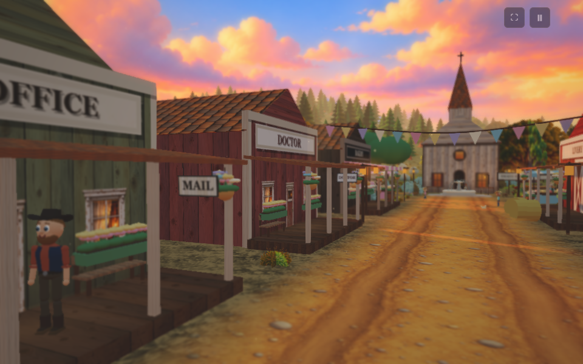

</div>

SP Creek is a cosy little western valley full of friendly townsfolk, a warm café, a river, forests with
fireflies, a flower meadow, a sunny beach and a hot air balloon on the hill. Watch it as a calm background
video, walk around and explore, or build your own corner of town.

> 🧸 **Our promise:** no weapons, no fighting, nothing scary, no jump scares. Even the old ghost town has
> only smiling ghosts and soft fog. Soft colours, warm light, calm sounds.

## ✨ Features

- 🎬 **Calm videos and episodes**: ready-made gentle tours (misty morning, moonlit night, rainy café, market
  day, a balloon ride, a little train trip and more) that play on their own
- 🚶 **Walk and ride**: stroll through town, run, jump and ride a horse
- 🗺️ **Places to explore**: main street with the bakery, general store, station and Honey Bun Café, a
  forest with fireflies and friendly owls, a pony farm, a playground, a flower meadow and waterfall lake,
  a sunset beach, a friendly ghost town, a glowing crystal mine and the balloon hilltop
- 🌗 **Day and night, four seasons**: golden afternoons, starry nights, autumn leaves and winter snow
- 🔨 **Build mode**: place houses, fences, roads, wells, lanterns and plants to grow the town
- 🎨 **Art styles**: oil paint, animated film, clean and flat
- 🎥 **Free camera and video export**: plan your own camera moves and save them as a video

## 🎮 Controls

**Keyboard and mouse**

| Key | What it does |
|---|---|
| <kbd>G</kbd> | Start or stop playing (walk and ride) |
| <kbd>W</kbd> <kbd>A</kbd> <kbd>S</kbd> <kbd>D</kbd> | Move |
| Mouse (click the picture, or drag) | Look around |
| <kbd>Shift</kbd> | Run, or gallop on a horse |
| <kbd>Space</kbd> | Jump (while playing) |
| <kbd>E</kbd> | Get on or off a horse |
| Mouse wheel | Zoom |
| <kbd>F</kbd> | Free camera (drag to look, <kbd>W</kbd><kbd>A</kbd><kbd>S</kbd><kbd>D</kbd> to fly, <kbd>E</kbd>/<kbd>Q</kbd> up and down) |
| <kbd>1</kbd> – <kbd>9</kbd> | Jump to a camera view |
| <kbd>P</kbd> | Pause the camera |
| <kbd>H</kbd> | Show or hide the menu |
| <kbd>R</kbd> / <kbd>Delete</kbd> / <kbd>Esc</kbd> | Build mode: rotate, remove, stop placing |

**Touch (tablet or phone)**

- Tap the menu at the top to pick a video, a place to visit, an art style or something to build.
- Drag on the picture to look around.
- Walking around in Play mode needs a keyboard for now.

## 🖼️ Pictures

| ☀️ Day | 🌙 Night |
|---|---|
| <br>**Main street** at golden hour | 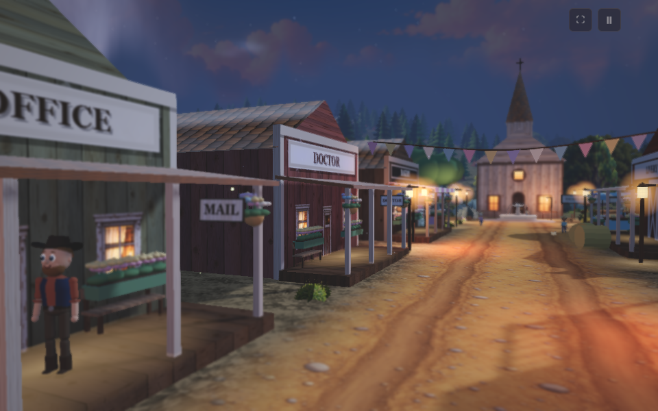<br>Lantern light on main street |
| 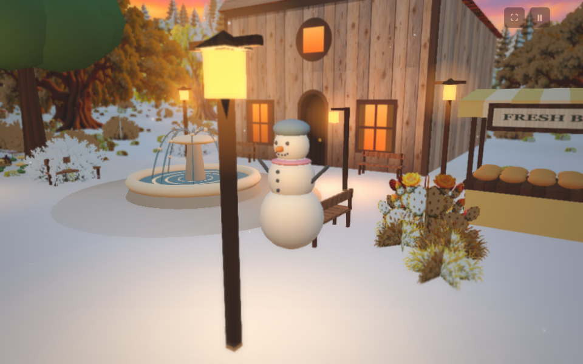<br>**Winter**: a snowman in the square | 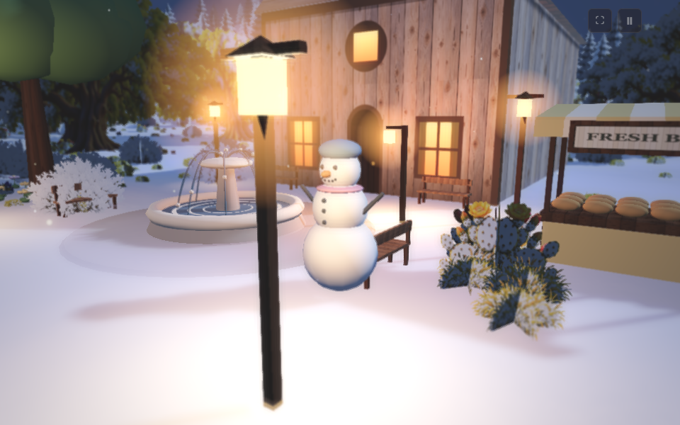<br>Cosy lamps on a snowy night |
| 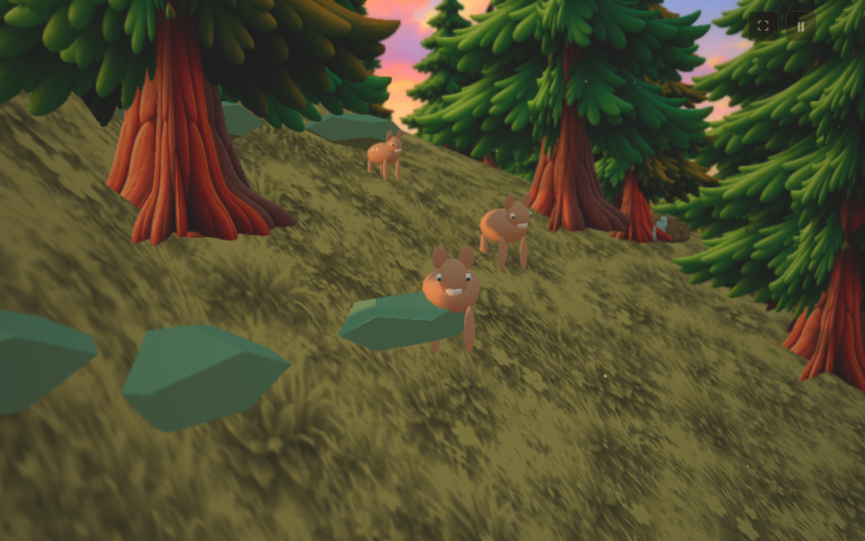<br>**Animal friends** at the forest edge | 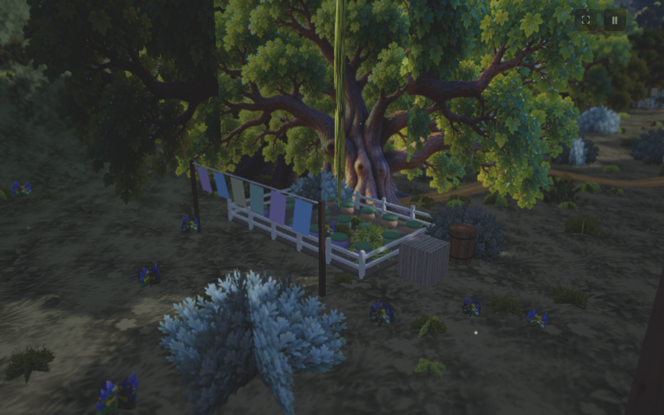<br>A village garden by moonlight |
| 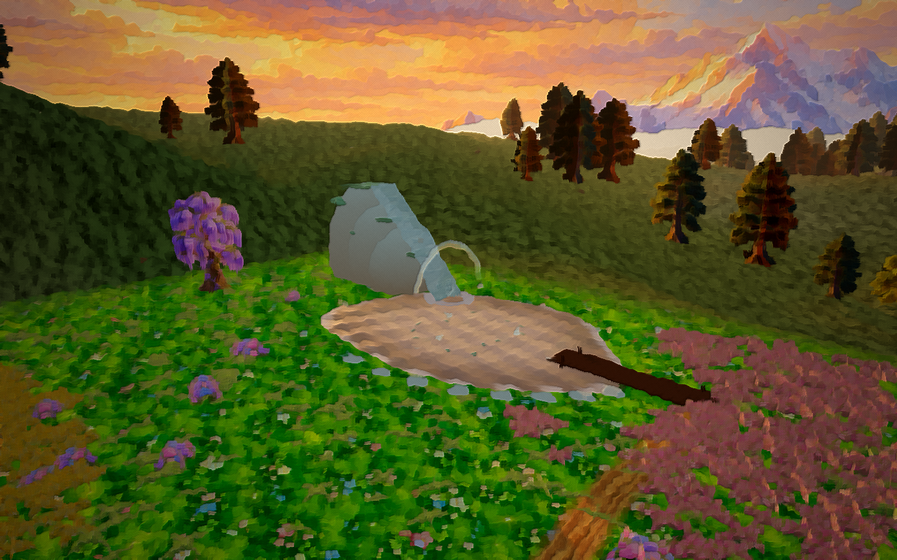<br>**Flower meadow and waterfall lake** | 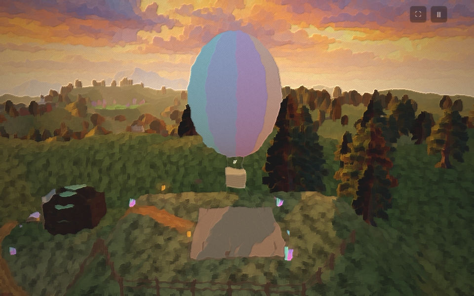<br>**The balloon hilltop** at sunset |

**See it move**

| | | |
|---|---|---|
| 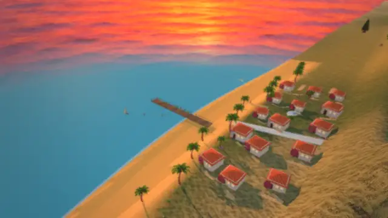<br>Sunset cove | 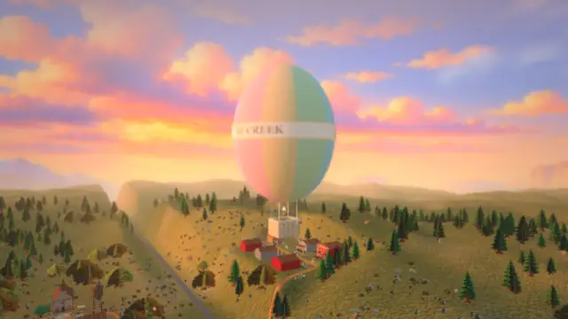<br>Balloon ride | 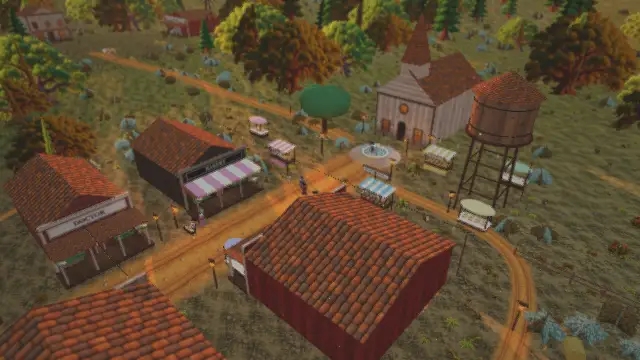<br>Market day |
| 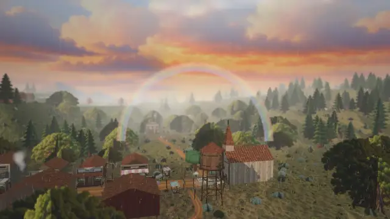<br>Rainbow over town | 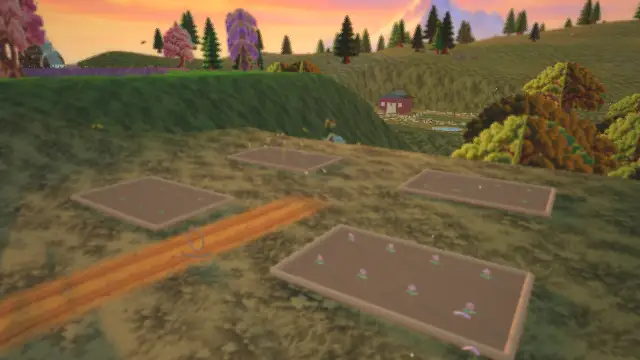<br>Garden growing | 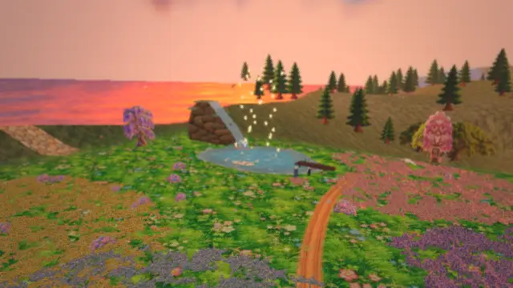<br>Lantern evening |

## 💻 Run it on your computer

```bash
python serve_world.py 8810
```

Then open http://localhost:8810. It needs only Python and a web browser: no installs, and it works offline
after the first load. Built with [Three.js](https://threejs.org).

## 💬 Follow along and join in

- 📣 **Weekly updates** with pictures in [Discussions](../../discussions/categories/weekly-updates)
- 💡 **Tell us what to build next** in [Ideas](../../discussions/categories/ideas). The most-voted idea gets built!
- ⭐ **Star the repo** to follow
- 🤝 **Become a supporter or partner**: see [JOIN.md](JOIN.md)

*Grown-ups only in the comments please (GitHub is 13+). Kind words only: this is a children's project.*

---
**Licence:** being chosen. Until a `LICENSE` file is added, everything here (code, art, characters and the
SP Creek name) is © Potluri family, all rights reserved. Built with [Three.js](https://threejs.org) and
[mp4-muxer](https://github.com/Vanilagy/mp4-muxer) (both MIT).
