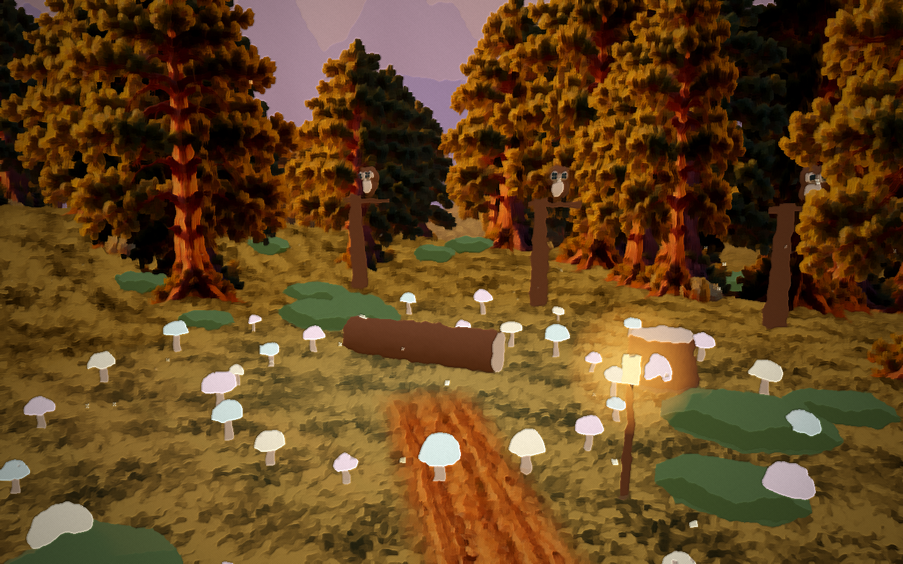

# 🌄 SP Creek

**A gentle, hand-painted 3D valley for children.** Calm videos, "let's build" videos and simple play: friendly
townsfolk, a cosy café, a river, forests with fireflies, a flower meadow, a glowing crystal mine and a hot air
balloon on the hill. Day and night, summer, autumn and winter.


> 🧸 **Our promise:** no weapons, no fighting, nothing scary, no jump scares. Even the old ghost town has only
> smiling ghosts and soft fog. Soft colours, warm light, calm sounds.

## What's inside

| | |
|---|---|
|  **Town center**: bakery, general store, station, Honey Bun Café |  **Forest**: fireflies, owls, a deer family |
|  **Flower meadow & waterfall lake**: rabbits, ducks, butterflies |  **Seasons**: autumn leaves, snow and a snowman |

- 🎬 **Ready-made calm videos** (10–30 minutes): misty morning, moonlit night, rainy café and a 2:30 grand tour
- 🔨 **Build mode**: place fences, wells, houses and lanterns to grow the town
- 🎨 **Art styles**: oil paint, animated film, clean and flat

## Try it

```bash
python serve_world.py 8810
```
Then open http://localhost:8810. It needs only Python and a browser (no installs, works offline after the first load).

## How it is made

SP Creek is a **pilot project by one family**, made with AI helpers:
**Claude** (lead and reviewer), **ChatGPT Codex** (builder) and **ChatGPT** (painted textures). Built with
[Three.js](https://threejs.org). Every change is reviewed and tested before it goes in.

## Follow along and join in

- 📣 **Weekly updates** with pictures in [Discussions](../../discussions/categories/weekly-updates)
- 💡 **Tell us what to build next** in [Ideas](../../discussions/categories/ideas). The most-voted idea gets built!
- ⭐ **Star the repo** to follow
- 🤝 **Become a supporter or partner**: see [JOIN.md](JOIN.md)

*Grown-ups only in the comments please (GitHub is 13+). Kind words only: this is a children's project.*

---
Code: MIT licence. Art, characters and the SP Creek name © Potluri family, all rights reserved.
