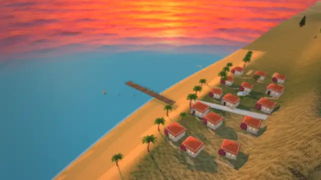
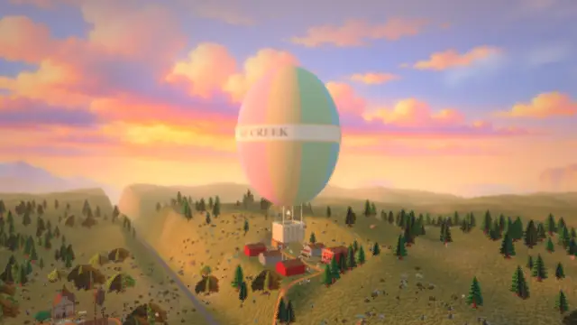
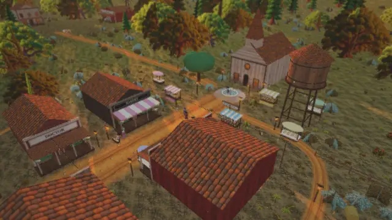
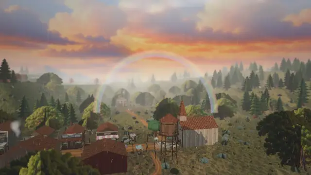
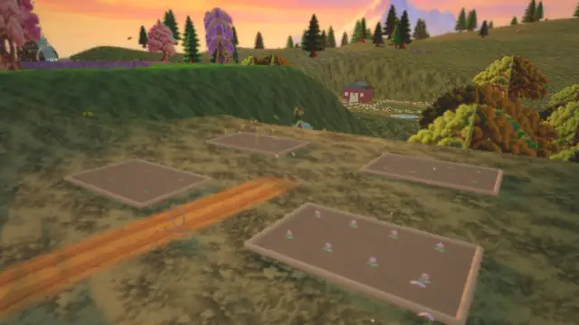
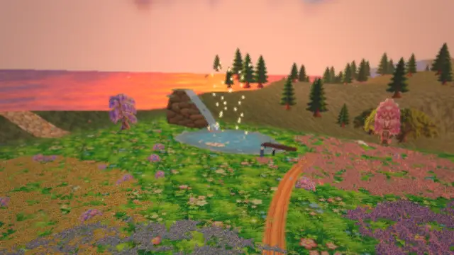

# 🌄 SP Creek

**A gentle, hand-painted 3D valley for children.** SP Creek is a small world made by one family for a children's
channel: calm background videos, "let's build" videos and simple play. Friendly townsfolk, a cosy café, a
river, fireflies in the forest and a hot air balloon on the hill. Day and night, summer, autumn and winter.

> 🧸 **Our promise:** no weapons, no fighting, nothing scary and no jump scares. Even Old Hollow, the old ghost
> town, has only smiling ghosts and soft fog. Soft colours, warm light, calm sounds and safe paths by the water.
> Every change is checked for this before it goes in.

## See it move

Short silent loops, straight from the world.

| | |
|---|---|
|  **Sunset Cove**: the golden beach and seaside village |  **Balloon ride**: a slow flight above the valley |
|  **Market day**: fruit, flowers, bread and toys |  **Rainbow**: the sky clears over town |
|  **Garden**: watch the beds grow |  **Lantern evening**: warm lights over the lake |

## Day and night

| ☀️ Day | 🌙 Night |
|---|---|
|  **Main street** at golden hour |  Lantern light on main street |
|  **Winter**: a snowman in the square |  Cosy lamps on a snowy night |
|  **Animal friends**: a deer family at the forest edge |  A village garden by moonlight |
|  **Flower meadow and waterfall lake** |  **Balloon hill** at sunset |

## Places to visit

- 🏡 **Town center**: the Honey Bun Café, bakery, general store, station and church, with warm lanterns
- 🏖️ **Beach and seaside village**: Sunset Cove, with boats and a golden shore
- 🌲 **Forest**: fireflies, soft light and friendly owls at night
- 🐴 **Farm**: a pony farm with a red barn, hay bales, a vegetable bed and a duck pond
- 🛝 **Playground**: gentle swings, a little slide, a seesaw and a sandbox
- 🎈 **Balloon hill**: a hot air balloon ready for a gentle ride
- 👻 **Old Hollow**: a foggy old town with smiling ghosts, mysterious but friendly
- 🌸 **Meadow and lake**: flowers, a waterfall and floating lanterns in the evening
- 🍎 **Market**: stalls of fruit, flowers, bread and toys in the square
- 🌱 **Garden**: growing beds you can watch change

Also in the world:

- 🎬 **Ready-made calm videos** (10–30 minutes): misty morning, moonlit night, rainy café and a grand tour
- 🔨 **Build mode**: place fences, wells, houses and lanterns to grow the town
- 🎨 **Art styles**: oil paint, animated film, clean and flat

## Run it on your computer

You need Python 3 and a web browser. Nothing else to install.

```bash
python serve_world.py 8810
```

Then open http://localhost:8810. It works offline once loaded. On Windows you can also double-click
`SP Creek.bat`.

## How it is made

SP Creek is a **pilot project by one family**, made with AI helpers:
**Claude** (lead and reviewer), **ChatGPT Codex** (builder) and **ChatGPT** (painted textures). Built with
[Three.js](https://threejs.org). Every change is reviewed and tested before it goes in.

## Follow along and join in

- 📣 **Weekly updates** with pictures: the first one is [here](docs/updates/week-1.md), and new ones go in
  [Discussions](../../discussions/categories/weekly-updates)
- 💡 **Tell us what to build next** in [Ideas](../../discussions/categories/ideas)
- 🤝 **Join in** as a friend, creator, builder, supporter or partner: see [JOIN.md](JOIN.md)
- 🛠️ **Want to help build?** Start with [CONTRIBUTING.md](CONTRIBUTING.md)
- ⭐ **Star the repo** to follow along

*Grown-ups only in the comments please (GitHub is 13+). Kind words only: this is a children's project.*

---
**Licence:** being chosen. Until a `LICENSE` file is added, everything here (code, art, characters and the
SP Creek name) is © Potluri family, all rights reserved. Built with [Three.js](https://threejs.org) and
[mp4-muxer](https://github.com/Vanilagy/mp4-muxer) (both MIT).
