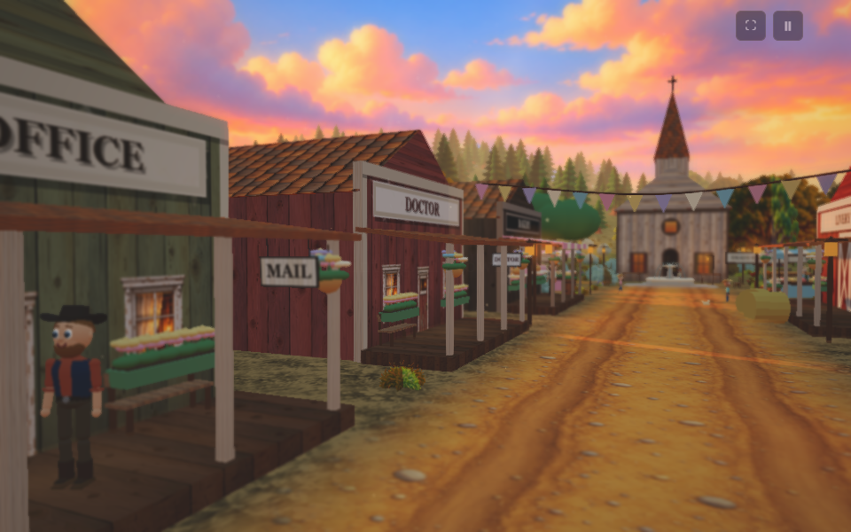

# 🌄 SP Creek



**Explore, build and unwind in a gentle, hand-painted 3D valley for children.**

## [▶ Play now](https://pa1potluri.github.io/SP-Creek/)

Free to play in your browser. Nothing to install; best on a computer or tablet.

## A little valley to make your own

- 🗺️ Explore a cosy town, firefly forest, waterfall lake, sunny cove and balloon hill.
- 🔨 Build your own corner of town with houses, plants, paths and friendly props.
- 🎨 Choose oil painting, Dreamy, Anime, Blocky, Paper Cut or Pixel Art.
- 🌅 Enjoy day and night, seasons, gentle weather and calm ready-made videos.
- ⭐ Find hidden stars, meet animal friends and decorate your cottage.
- 🧸 A calm, child-friendly world with soft colours and friendly characters.

Layout v2 keeps the world in view with picture-led navigation and nearby controls.

## More games by PKP Studio

- [The Last Outlaw on itch.io](https://pkp-studio.itch.io/the-last-outlaw)
- [More projects by PKP Studio on GitHub](https://github.com/pa1potluri)

## Work with me

For collaborations and project enquiries, [connect with Pavan Potluri on LinkedIn](https://www.linkedin.com/in/pavanpotluri/).

## Run locally

```bash
python serve_world.py 8810
```

Open [localhost:8810](http://localhost:8810). The game uses local libraries and assets, with no build step.

## How it is made

SP Creek is a **pilot project by one family**, made with AI helpers:
**Claude** (lead and reviewer), **ChatGPT Codex** (builder) and **ChatGPT** (painted textures). Built with
[Three.js](https://threejs.org). Every change is reviewed and tested before it goes in.

See [CREDITS.md](CREDITS.md) for libraries and asset acknowledgements, [CONTRIBUTING.md](CONTRIBUTING.md) to contribute, and [JOIN.md](JOIN.md) to support the project.

---
**Licence:** being chosen. Until a `LICENSE` file is added, everything here (code, art, characters and the
SP Creek name) is © Potluri family, all rights reserved. Built with [Three.js](https://threejs.org) and
[mp4-muxer](https://github.com/Vanilagy/mp4-muxer) (both MIT).
