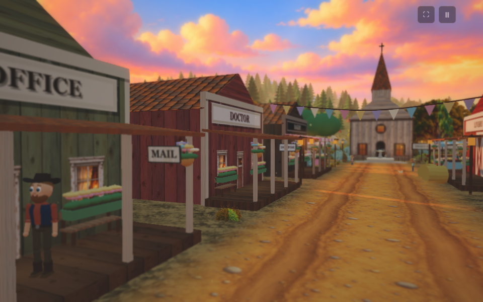
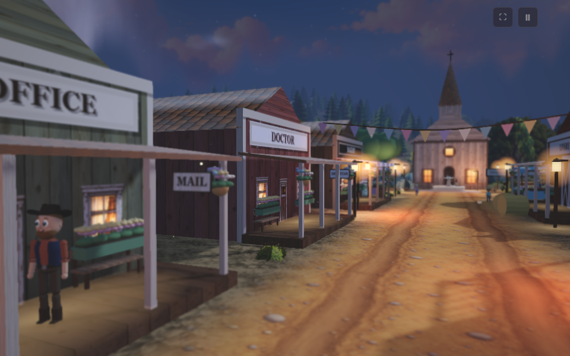
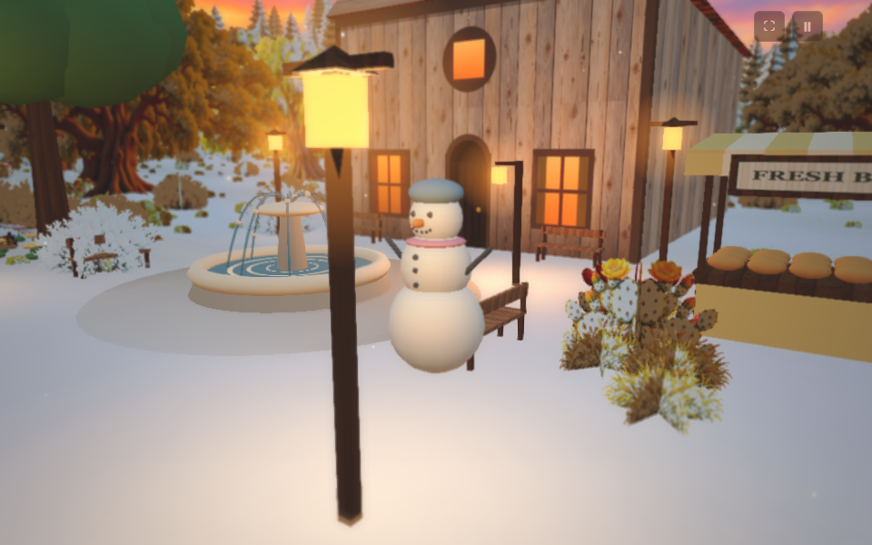
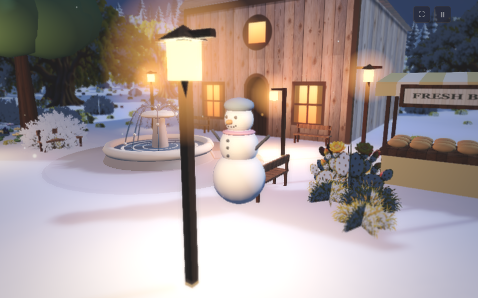
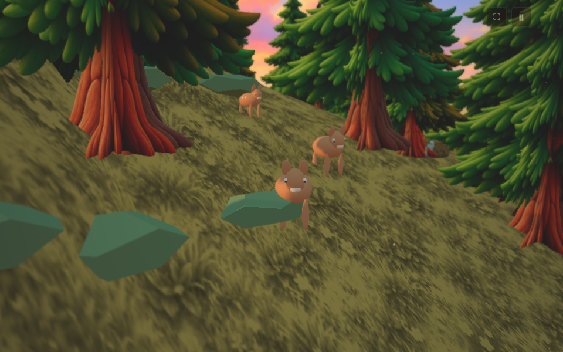
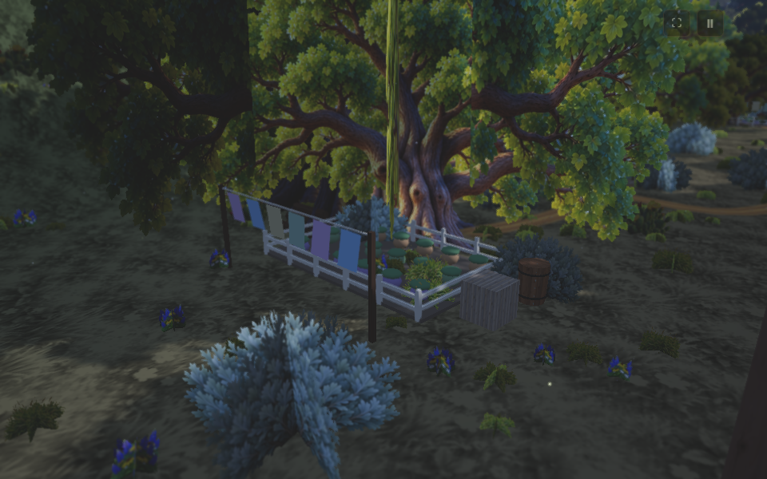
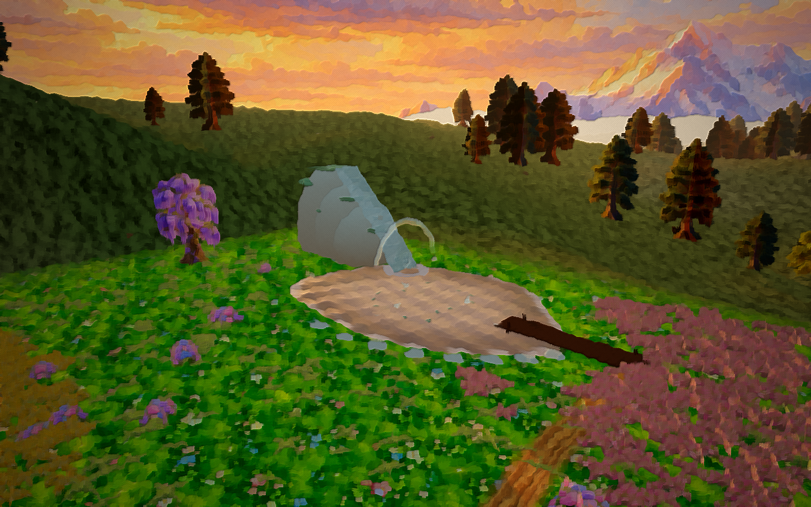
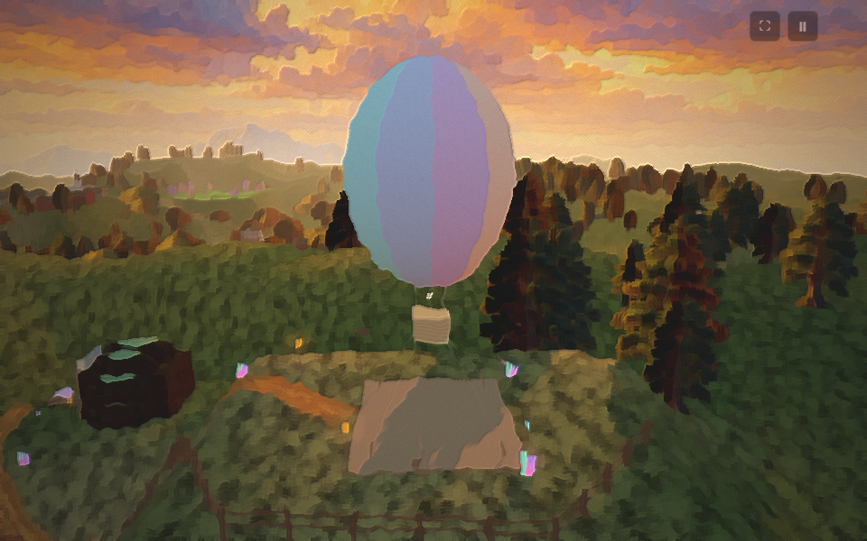

# 🌄 SP Creek

**A gentle, hand-painted 3D valley for children.** Calm videos, "let's build" videos and simple play: friendly
townsfolk, a cosy café, a river, forests with fireflies, a flower meadow, a glowing crystal mine and a hot air
balloon on the hill. Day and night, summer, autumn and winter.

> 🧸 **Our promise:** no weapons, no fighting, nothing scary, no jump scares. Even the old ghost town has only
> smiling ghosts and soft fog. Soft colours, warm light, calm sounds.

## Day and night in SP Creek

| ☀️ Day | 🌙 Night |
|---|---|
|  **Main street** at golden hour |  Lantern light on main street |
|  **Winter**: a snowman in the square |  Cosy lamps on a snowy night |
|  **Animal friends**: a deer family at the forest edge |  A village garden by moonlight |
|  **Flower meadow & waterfall lake** |  **The balloon hilltop** at sunset |

Also: a bakery, general store, station and the Honey Bun Café, a forest with fireflies and friendly owls,
a friendly ghost town and a glowing crystal mine.

- 🎬 **Ready-made calm videos** (10–30 minutes): misty morning, moonlit night, rainy café and a 2:30 grand tour
- 🔨 **Build mode**: place fences, wells, houses and lanterns to grow the town
- 🎨 **Art styles**: oil paint, animated film, clean and flat

## Play in your browser

**https://pa1potluri.github.io/SP-Creek/**

Nothing to install: it opens straight in the browser. It works best on a computer or tablet.

## Try it locally

```bash
python serve_world.py 8810
```
Then open http://localhost:8810. It needs only Python and a browser (no installs, works offline after the first load).

## How it is made

SP Creek is a **pilot project by one family**, made with AI helpers:
**Claude** (lead and reviewer), **ChatGPT Codex** (builder) and **ChatGPT** (painted textures). Built with
[Three.js](https://threejs.org). Every change is reviewed and tested before it goes in.

## Follow along and join in

- 📣 **Weekly updates** with pictures in [Discussions](../../discussions/categories/weekly-updates)
- 💡 **Tell us what to build next** in [Ideas](../../discussions/categories/ideas). The most-voted idea gets built!
- ⭐ **Star the repo** to follow
- 🤝 **Become a supporter or partner**: see [JOIN.md](JOIN.md)

*Grown-ups only in the comments please (GitHub is 13+). Kind words only: this is a children's project.*

---
**Licence:** being chosen. Until a `LICENSE` file is added, everything here (code, art, characters and the
SP Creek name) is © Potluri family, all rights reserved. Built with [Three.js](https://threejs.org) and
[mp4-muxer](https://github.com/Vanilagy/mp4-muxer) (both MIT).
